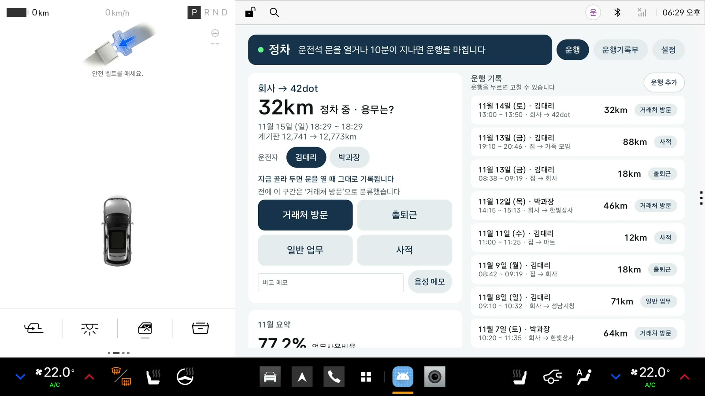
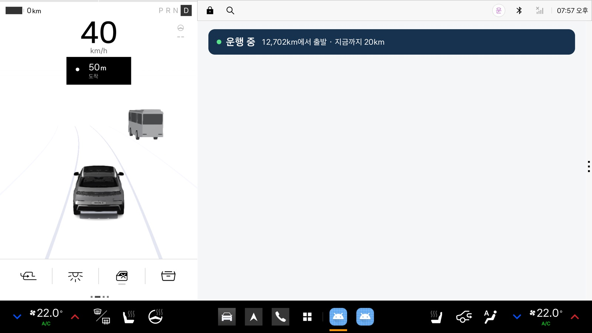
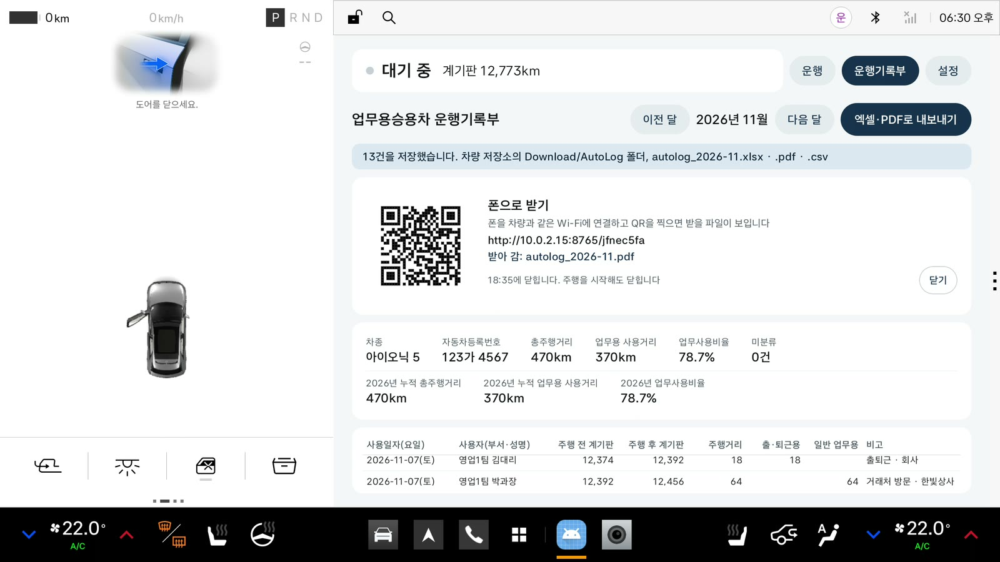
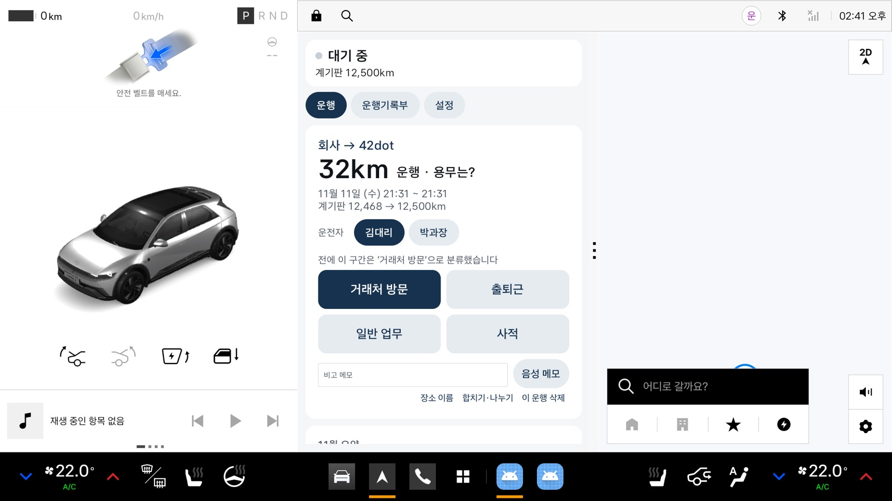
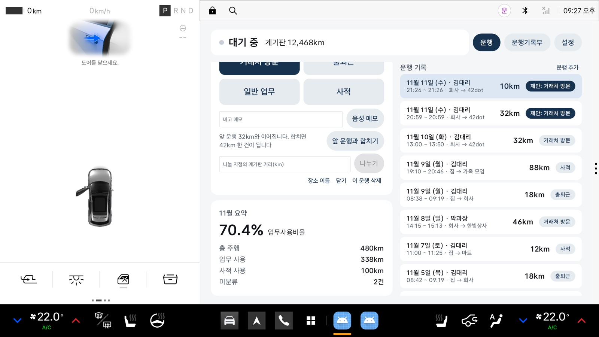

# AutoLog

차량이 직접 쓰는 업무용 승용차 운행기록부. 현대자동차그룹 차량용 앱 개발 공모전 출품작.

기어, 계기판 누적 거리, 운전석 도어 신호로 운행 한 건의 시작과 끝을 자동으로 잡고, 기어를 P에 놓으면 뜨는 카드에서 버튼 하나로 용무만 받는다. 운전자의 폰에는 아무것도 설치하지 않는다. 월말에는 국세청 서식 항목 그대로 엑셀, PDF, CSV로 내보내고, QR을 찍은 폰이 파일을 받아 간다.

Pleos Connect(Android Automotive) 차량용 앱이다. Pleos Connect 에뮬레이터 2.1.0에서 만들고 확인했다. 실차에서는 확인하지 못했다.

| 기어를 P에 놓으면 뜨는 용무 카드 | 주행 중에는 상태 한 줄만 |
|---|---|
|  |  |
| 폰으로 받기(QR) | 내보낸 PDF |
|  |  |
| 앱 영역 1개(옆에 내비) | 끊긴 운행 합치기·나누기 |
|  |  |

## 어떻게 동작하나
1. 기어가 P를 벗어나면 운행을 연다. 그때의 계기판 거리가 주행 전 거리다.
2. 주행 중에는 화면에 상태 한 줄만 둔다. 입력은 받지 않는다.
3. 기어가 P로 돌아오면 문을 열기 전에 용무 카드가 먼저 뜬다. 버튼 하나로 용무를 골라 둔다. 다시 출발하면 같은 운행이 이어지고 골라 둔 용무는 버린다.
4. 운전석 문이 열리면(또는 10분이 지나면) 운행을 닫는다. 주행 후 계기판 거리와 도착지, 골라 둔 용무를 적는다. 운행기록부 한 줄이 끝난다.
5. 고르지 않고 내렸으면 카드가 남는다. 다음에 탔을 때 고른다.

## 지금 되는 것 (v0.9.0)
- 첫 실행 안내와 동의: 무엇을 기록하고 어디에 쓰며 어디에 두는지 알리고, '동의하고 시작'을 누른 뒤에만 기록한다. 그 전에는 차량 신호를 구독하지 않는다.
- 운행 자동 감지: 기어가 P를 벗어나면 운행을 열고, P로 돌아온 뒤 운전석 문이 열리면 닫는다. 잠깐 정차했다가 다시 출발하면 같은 운행으로 잇는다. 문이 열리지 않아도 정한 시간(기본 10분)이 지나면 닫는다. 계기판 거리가 늘었으면 짧은 이동도 한 줄로 남긴다. 정한 거리(기본 1km)보다 짧은 이동은 '짧은 이동'으로 표시하고 용무를 묻지 않는다.
- 주행 전·후 계기판 거리와 주행거리 자동 기록
- 출발지와 도착지: 출발지는 운행이 열릴 때의 주소, 도착지는 내장 내비에 설정한 목적지 이름(없으면 정차한 곳의 주소)
- 장소 이름: 운행 카드에서 출발지·도착지에 '집', '회사' 또는 직접 적은 이름을 붙인다. 그 자리(반경 150m)의 운행은 주소 대신 그 이름으로 보인다.
- 빈 구간 알림과 운행 추가: 앞 운행이 끝난 계기판 거리와 다음 운행이 시작한 거리가 0.5km 넘게 벌어져 있으면 '기록이 빈 구간'으로 알리고, 두 계기판 값을 채운 운행 추가를 연다. 자동으로 기록되지 않은 운행은 날짜와 계기판 거리로 적는다.
- 운행 합치기·나누기: 같은 날 계기판 거리가 이어지는 앞 운행과 합치거나, 중간 계기판 거리에서 둘로 나눈다. 원래 운행은 지운 표시로 남아서, 합치거나 나눈 것을 되돌릴 수 있다.
- 용무 카드: 기어를 P에 놓으면 문을 열기 전에 뜬다. 거래처 방문, 출퇴근, 일반 업무, 사적. 운전자 고르기, 비고 메모(글자, 음성 한 마디, 최근 메모 다시 쓰기). 골라 둔 용무는 문이 열릴 때 기록되고, 기록한 뒤 20초 동안 되돌릴 수 있다. 닫힌 운행은 목록에서 골라 고치거나 지운다. 지운 운행은 '지운 운행'에서 되살린다.
- 용무 제안: 같은 두 곳을 오간 지난 운행의 분류를 먼저 따르고, 없으면 집과 회사 사이 운행은 출퇴근으로, 그것도 아니면 같은 도착지의 분류를 따른다. 눌러야 확정된다.
- 정리할 운행: 미분류가 2건 이상 쌓이면 '제안 N건 모두 수락'으로 한 번에 정리한다. 달이 3일 이하로 남았을 때는 미분류가 한 건이어도 알린다.
- 이번 달 요약: 총 주행, 업무 사용, 사적 사용, 업무사용비율, 미분류 건수
- 운행기록부 탭: 한 달 운행을 국세청 고시 서식의 항목 순서(사용일자, 사용자, 주행 전·후 계기판 거리, 주행거리, 출·퇴근용, 일반 업무용, 비고)로 보여 주고, 그 해의 누적도 함께 낸다. 엑셀 파일(.xlsx), 서식 모양의 PDF, CSV로 내보낸다.
- 폰으로 받기: 내보낸 뒤 누르면 QR이 뜨고, 같은 네트워크의 폰이 그 주소로 들어와 파일을 받아 간다. 폰이 받아 가면 차량 화면에 알린다. 연 동안(5분)만, 열 때마다 바뀌는 주소로만 열리고, 주행을 시작하면 닫힌다. 서버를 거치지 않는다.
- 음성 안내: 정차하면 용무를 고르라고, 운행이 닫히면 무엇으로 기록했는지 한 문장으로 알린다. 설정에서 끌 수 있다.
- 주행 중에는 상태 한 줄만 보이고 목록과 입력은 감춘다.
- 백그라운드 기록: 내비 같은 다른 앱이 화면을 차지해도 포그라운드 서비스로 기록이 이어진다.
- 자동 시작: 차량이 켜진 뒤와 앱 업데이트 뒤에 앱을 열지 않아도 기록을 시작한다.
- 운행 복구: 주행 중에 앱이 꺼져도 출발 시각과 출발 계기판 거리를 남겨 두었다가, 다시 켜지면 같은 운행으로 이어서 닫는다.
- 설정: 차량 정보, 운전자, 운행을 마치는 기준(대기 시간), 용무를 묻지 않는 짧은 이동의 기준, 용무 버튼 이름(업무 버튼 두 개), 음성 안내, 이름 붙인 장소, 기록 안내 다시 보기, 데이터 전체 삭제
- 화면: 앱 영역 2개(넓은 창)에서는 두 열, 앱 영역 1개(좁은 창)에서는 한 열
- 글자 입력: 입력 칸 바깥을 누르거나 화면을 밀면 키보드가 내려간다.

에뮬레이터에서 61개 시나리오를 돌렸고 단위 테스트는 87건이다. 기록은 [docs/시나리오_점검.md](docs/시나리오_점검.md)에 있다.

## 구조
```
app/src/main/java/com/autolog/app/
  AutoLogApp.kt             기록기를 화면이 아니라 Application에 둔다. 동의한 뒤에만 기록을 켠다
  trip/TripDetector.kt      운행 경계를 잡는 상태 머신 (순수 코틀린, 단위 테스트 대상)
  trip/TripRecorder.kt      차량 신호를 상태 머신에 넘기고 닫힌 운행을 저장. 정차 중에 고른 용무를 맡아 둔다
  trip/OpenTripStore.kt     열려 있는 운행의 출발 정보를 디스크에 보관 (복구용)
  trip/TripRecorderService.kt  화면이 뒤로 가도 프로세스가 동결되지 않게 하는 포그라운드 서비스
  trip/BootReceiver.kt      차량이 켜진 뒤와 앱 업데이트 뒤에 기록을 다시 시작
  trip/PurposeSuggester.kt  지난 분류와 집·회사 이름으로 용무 제안 (순수 코틀린, 단위 테스트 대상)
  trip/Ledger.kt            계기판 거리가 벌어진 빈 구간 찾기, 짧은 이동 판정 (순수 코틀린, 단위 테스트 대상)
  trip/TripEdits.kt         운행 합치기와 나누기, 되돌리기, 지운 운행 되살리기 (순수 코틀린, 단위 테스트 대상)
  place/PlaceBook.kt        출발지·도착지를 저장한 장소 이름으로 바꿔 읽기, 좌표 거리 계산 (순수 코틀린, 단위 테스트 대상)
  place/PlaceStore.kt       이름 붙인 장소 보관
  report/Logbook.kt         운행기록부 서식 계산, 내보내는 표와 CSV (순수 코틀린, 단위 테스트 대상)
  report/Xlsx.kt            엑셀 파일(.xlsx) 쓰기. 외부 라이브러리 없음 (순수 코틀린, 단위 테스트 대상)
  report/LogbookPdf.kt      서식 모양의 PDF 그리기. 안드로이드의 PdfDocument만 사용
  report/MonthEnd.kt        월말 미분류 안내 (순수 코틀린, 단위 테스트 대상)
  report/LogbookExporter.kt 파일을 차량 저장소 Download/AutoLog와 앱 내부 폴더에 저장
  share/QrCode.kt           QR 코드 만들기. 외부 라이브러리 없음 (순수 코틀린, 단위 테스트 대상)
  share/PhoneShare.kt       폰으로 받기. 사용자가 연 동안만 여는 작은 웹 서버 (순수 코틀린, 단위 테스트 대상)
  vehicle/VehicleSignals.kt Pleos Vehicle SDK에서 기어·계기판 거리·운전석 도어를 구독
  vehicle/NaviPlace.kt      Pleos NaviHelper SDK에서 현재 주소와 내비 목적지 이름을 조회
  vehicle/VoiceGuide.kt     Pleos TextToSpeech SDK(ON_DEVICE)로 음성 안내
  vehicle/VoiceMemo.kt      Pleos SpeechToText SDK(ON_DEVICE)로 한 마디 메모
  vehicle/DrivingRestriction.kt  AAOS 주행 규제 상태
  data/                     Room: Trip, TripDao, AppDatabase(v7) / ProfileStore(차량·운전자·설정·동의) / 시연용 예시 데이터
  ui/                       Compose 화면: AppScreen(상태 배너와 탭), 첫 실행 안내, 운행, 운행기록부, 설정
app/src/debug/              디버그 빌드에만 들어가는 개발용 화면과 시연 준비용 수신기 (출시 빌드 제외)
app/src/test/               단위 테스트 87건: 상태 머신 15, 빈 구간·짧은 이동 7, 용무 제안 10, 장소 10, 운행기록부 9, 엑셀 6, 합치기·나누기·되돌리기·되살리기 18, 월말 안내 3, QR 코드 4, 폰으로 받기 5
```

## 쓰는 Pleos Connect SDK
| 신호 | API | 권한 |
|---|---|---|
| 기어 | Vehicle SDK `getGear().registerGearSelection`, `getCurrentGearSelectionState` | `pleos.car.permission.CAR_DRIVE` |
| 계기판 누적 거리 | Vehicle SDK `getOdometer().registerDistanceDriven`, `getCurrentDistanceDriven` | `pleos.car.permission.CAR_DRIVE` |
| 운전석 도어 | Vehicle SDK `getDoor().registerDoorPosition`, `getCurrentDoorPosition` | `pleos.car.permission.CAR_DOORS` |
| 현재 주소와 좌표 | NaviHelper SDK `getCurrentLocationInfo` | `pleos.car.permission.NAVI_ROUTE` |
| 내비 목적지 이름 | NaviHelper SDK `onRouteStarted`, `onDestinationInfo`, `onDestinationArrived` | `pleos.car.permission.NAVI_ROUTE` |
| 음성 안내 | TextToSpeech SDK `speak` (ON_DEVICE 모드, 앱 등록 불필요) | `pleos.car.permission.TTS_SERVICE` |
| 음성 메모 | SpeechToText SDK `request`, `stop` (ON_DEVICE 모드, 앱 등록 불필요) | `pleos.car.permission.STT_SERVICE` |
| 주행 규제 | AAOS `CarUxRestrictionsManager` | 없음 |

조회·구독 API만 쓴다. 차량을 제어하거나 내비 경로를 바꾸는 권한은 없다.

출시 빌드에 들어가는 권한은 위 다섯 가지와 `RECEIVE_BOOT_COMPLETED`(자동 시작), `FOREGROUND_SERVICE`, `FOREGROUND_SERVICE_SPECIAL_USE`(백그라운드 기록)이다. 여기에 SDK가 자기 매니페스트로 넣는 권한이 합쳐진다. TextToSpeech·SpeechToText SDK의 `android.permission.INTERNET`, Vehicle SDK의 `VEHICLE_BINDING`. 앱 코드가 네트워크를 쓰는 곳은 폰으로 받기 하나다(`android.permission.INTERNET`). 사용자가 연 동안만 차량 안에서 포트를 열고, 차량 밖으로 나가는 연결은 만들지 않는다.
`CAR_SEATS`, `CAR_INFO`, `FUSED_LOCATION`, `NAVI_ROUTE_SEARCH`, `android.car.permission.CAR_POWERTRAIN`은 디버그 빌드의 개발용 화면에서만 쓴다.

## 빌드 환경
| 항목 | 값 |
|---|---|
| JDK | 17 |
| Gradle wrapper | 8.10.2 |
| Android Gradle Plugin | 8.8.2 |
| Kotlin | 2.0.0 (Compose 컴파일러 플러그인, KSP 2.0.0-1.0.24) |
| compileSdk / targetSdk / minSdk | 35 / 34 / 28 |
| Pleos SDK | `ai.pleos.playground:Vehicle:2.3.2`, `NaviHelper:3.0.5`, `TextToSpeech:3.3.1`, `SpeechToText:3.3.1` |
| 테스트 환경 | Pleos Connect Emulator v2.1.0 (AVD `Pleos_Connect_v2.1`, Android 14) |

에뮬레이터와 Virtual Console은 Pleos Playground 개발 문서대로 설치한다. `tools/start_emulator.sh`가 에뮬레이터를 띄우고 Virtual Console 포트(8088)를 연다.

## 빌드와 실행
```bash
export JAVA_HOME=$(/usr/libexec/java_home -v 17)
export ANDROID_HOME="$HOME/Library/Android/sdk"
ADB="$ANDROID_HOME/platform-tools/adb"

./gradlew :app:testDebugUnitTest :app:assembleDebug
$ADB -e install -r app/build/outputs/apk/debug/app-debug.apk
$ADB -e shell am start -n com.autolog.app/.ui.MainActivity
$ADB -e logcat -s AUTOLOG:I
```
`local.properties`(`sdk.dir=...`)는 저장소에 넣지 않는다. Android Studio로 열면 자동으로 만들어진다.

## 시연
```bash
# 0) 에뮬레이터를 새로 켰으면 계기판이 0km다. 먼저 맞춘다.
tools/vc.sh odo 12340

# 1) 저장된 것을 지우고 예시 차량·운전자·운행 12건으로 시작 (앱은 사용자 10으로 실행된다)
$ADB -e shell pm clear --user 10 com.autolog.app
$ADB -e shell am start -n com.autolog.app/.ui.MainActivity --ez seed true

# 2) 운행 한 건 재생: 기어 D, 32km 주행, 기어 P, 운전석 문 열림
tools/demo_scenario.sh 32

# 3) 내비 목적지를 넣고 재생: 도착지 이름과 용무 제안이 카드에 뜬다 (디버그 빌드 전용)
tools/demo_scenario.sh 32 route

# 4) 신호를 하나씩 보내기
tools/vc.sh door close gear Drive speed 40 odo +15 speed 0 gear Park door open

# 5) 명령 대신 버튼으로: 조작판을 띄우고 브라우저에서 http://127.0.0.1:8090/ 을 연다
python3 tools/panel.py
```
예시 차량·운전자·운행은 디버그 빌드에서, 비어 있을 때만 들어간다. 예시로 시작하면 첫 실행 안내는 건너뛰고, 지금 서 있는 자리를 '회사'로 저장한다. 그래서 재생한 운행이 "회사 → 42dot"으로 뜬다.

좁은 창(앱 영역 1개)은 에뮬레이터 화면 오른쪽 끝의 창 막대(점 세 개)를 왼쪽으로 끌면 된다.

월말 안내처럼 날짜에 따라 달라지는 화면은 디버그 빌드에서 '지금'을 바꿔 본다. 앱을 끄고 `--el now <밀리초>`를 붙여 연다.
```bash
$ADB -e shell am force-stop --user 10 com.autolog.app
$ADB -e shell am start -n com.autolog.app/.ui.MainActivity --el now 1795834800000   # 2026-11-28 12:00 KST
```

내보낸 파일은 차량 저장소의 Download/AutoLog 폴더와 앱 내부 폴더에 저장된다. 차 밖으로는 '폰으로 받기'로 가져간다. 에뮬레이터의 주소(10.0.2.x)는 밖에서 닿지 않으므로, 포트 전달로 이 컴퓨터가 폰 역할을 한다.
```bash
$ADB -e forward tcp:8765 tcp:8765
# 화면에 뜬 주소의 마지막 값(예: k3f9x2ab)을 붙인다. 브라우저로 열면 받을 파일 목록이 보인다
curl -O http://127.0.0.1:8765/k3f9x2ab/autolog_2026-11.pdf
```

내보낸 파일의 예시는 `docs/sample/`에 있다. 개발 중에는 이렇게도 꺼낸다.
```bash
$ADB -e shell "run-as com.autolog.app --user 10 sh -c 'cat files/export/autolog_2026-11.xlsx'" > autolog_2026-11.xlsx
```

음성 메모를 마이크 없이 확인하려면 녹음한 말(16kHz, 16비트, 모노 PCM)을 앱 폴더에 넣고 수신기를 부른다. 정차 중인 운행이 있으면 그 카드의 메모에, 없으면 가장 최근 운행의 메모에 적힌다.
```bash
say -v Yuna "계약서 미팅" -o memo.aiff && afconvert -f WAVE -d LEI16@16000 -c 1 memo.aiff memo.wav
# memo.wav에서 헤더를 뗀 PCM 앞뒤로 무음을 붙여 demo_voice.pcm으로 만든다
$ADB -e push demo_voice.pcm /data/local/tmp/ && $ADB -e shell "cat /data/local/tmp/demo_voice.pcm | run-as com.autolog.app --user 10 sh -c 'cat > files/demo_voice.pcm'"
$ADB -e shell am broadcast --user 10 -n com.autolog.app/.debug.DemoVoiceReceiver
```

## 개발용 신호 확인 화면
```bash
$ADB -e shell am start -n com.autolog.app/.debug.SignalCheckActivity
```
기어, 계기판 거리, 도어, 착석, 위치, 현재 주소, 내비 목적지, 음성 합성을 한 화면에서 확인한다. 디버그 빌드에만 있다.

## 내려받기
설치해 볼 수 있는 디버그 APK는 저장소 Releases에 있다. Pleos Connect 에뮬레이터에 `adb install`로 설치한다. 예시 운행을 넣는 시연 준비 기능(`--ez seed true`)은 디버그 빌드에만 있다.

## 확인하지 못한 것과 한계
- 실차에서는 돌려 보지 못했다. 모든 확인은 에뮬레이터와 Virtual Console로 했다.
- 음성 메모는 녹음한 말을 인식에 넣어 확인했다. 실제 마이크로 말한 음성은 확인하지 못했다.
- 에뮬레이터 위치가 고정이라, 서로 다른 좌표의 장소가 구분되는 것은 단위 테스트로만 확인했다.
- 내비 도착 이벤트는 에뮬레이터 내비가 경로를 바로 끝내서 확인하지 못했다. 목적지 이름은 경로 시작 이벤트로 받는다.
- 포그라운드 서비스와 부팅 후 자동 시작이 Pleos App Market 심사에서 허용되는지는 모른다.
- 폰으로 받기는 에뮬레이터에서 포트 전달로 확인했다. 실차에서 폰이 차량 Wi-Fi에 붙었을 때 차량 화면 기기에 닿는지는 확인하지 못했다.
- 파일을 메일로 보내는 기능, Gleo 음성 비서 연동은 없다.
- 좌석 착석 신호는 에뮬레이터에서 값이 반대로 나와 쓰지 않는다. 운행 종료는 운전석 문과 대기 시간으로 판정한다.
